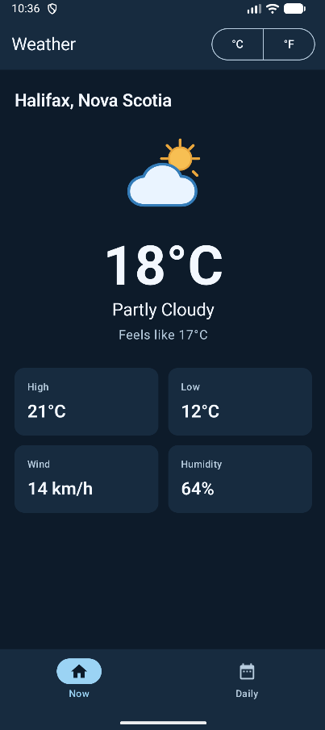
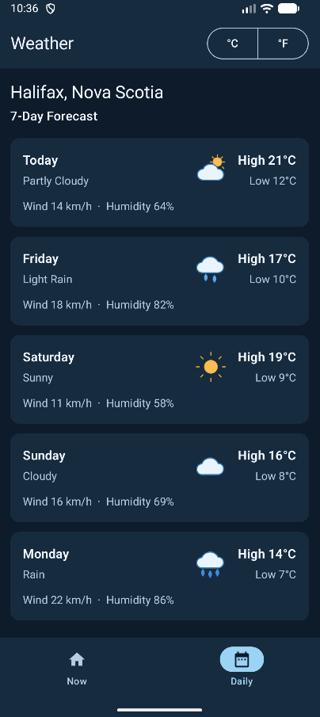

# WeatherApp

**NSCC MOBI3002 · Assignment 1 — Weather App, Phase 1**

WeatherApp is a two-screen Android weather application built with **Kotlin**, **Jetpack Compose**, and **Material 3**. It presents current weather conditions and a seven-day forecast for Halifax, Nova Scotia, using deliberately **static placeholder data**. Phase 1 focuses on the user interface, navigation, and presentation; live weather data and device-location integration are outside its scope.

## Screenshots

| Current Weather — Now | Seven-Day Forecast — Daily |
| :---: | :---: |
|  |  |

*Screenshots show the coastal dark theme with the Celsius unit selected. A matching light theme is also supported.*

## Features

- **Current Weather (Now):** Location, weather condition and custom icon, current temperature, feels-like temperature, daily high/low, wind speed and humidity.
- **Seven-Day Forecast (Daily):** Scrollable forecast cards with condition-specific icons, high/low temperatures, wind speed and humidity.
- **Celsius/Fahrenheit selector:** Switch temperature units from the top app bar. The choice applies across both screens and is retained across navigation and supported activity recreation.
- **Bottom navigation:** Switch between Now and Daily using Jetpack Navigation Compose.
- **Coastal visual theme:** Custom Material 3 light and dark colour schemes, consistent cards and typography.
- **Custom branding:** Vector weather illustrations, an adaptive launcher icon and a native Android splash screen.

## Technology

- Kotlin
- Jetpack Compose and Material 3
- Jetpack Navigation Compose
- AndroidX Core SplashScreen
- Gradle Kotlin DSL with a version catalog (`gradle/libs.versions.toml`)
- Minimum Android version: **Android 8.0 (API 26)**

## Running the app

1. Clone the repository:

   ```bash
   git clone https://github.com/PlumyPlumPlum/WeatherApp.git
   ```

2. Open the cloned **WeatherApp** project folder in Android Studio.
3. Allow Gradle to sync and install the Android SDK/build tools requested by the project, if necessary.
4. Select an Android emulator or connected device running **API 26 or newer**.
5. Choose the **app** run configuration and click **Run**.

No API key, location permission, network connection or backend is required to display the Phase 1 sample weather.

## Project structure

```text
app/src/main/
├── java/com/example/weatherapp/
│   ├── MainActivity.kt              # Android entry point and native splash setup
│   ├── WeatherApp.kt                # App scaffold, top bar, navigation and unit state
│   ├── data/
│   │   ├── CurrentWeather.kt        # Current conditions model
│   │   ├── ForecastDay.kt           # Daily forecast model
│   │   └── SampleWeatherData.kt     # Phase 1 placeholder weather
│   └── ui/
│       ├── TemperatureUnit.kt       # Celsius/Fahrenheit formatting
│       ├── components/              # Bottom navigation and condition icons
│       ├── screens/                 # Now and Daily screen composables
│       └── theme/                   # Light/dark colours and typography
└── res/
    ├── drawable/                   # Weather vectors and brand artwork
    ├── mipmap-anydpi/              # Adaptive launcher icon definitions
    └── values/splash_screen.xml    # Native splash theme
```

## Implementation approach

Weather data is represented by Kotlin data classes and provided by `SampleWeatherData`. The screen composables **receive** weather data rather than defining their own sample values. `WeatherApp` owns the selected temperature unit and passes it to both screens; `formatTemperature()` converts values for display while preserving the original Celsius data. `WeatherIcon` selects an Android vector drawable based on the weather condition.

This separation makes it easier to replace placeholder values with a weather API in a later assignment without rebuilding the entire interface.

## Phase 1 testing

The application was manually checked in an Android emulator for:

- Now/Daily navigation and selected tab indicators
- Scrolling through all seven forecast days
- Celsius/Fahrenheit conversions on both screens
- Unit selection retained while switching screens and rotating
- Light and dark theme readability
- Responsive layout, content visibility and scrolling
- Custom launcher icon and splash screen on a cold launch

## Phase 1 limitation

**Weather values and forecast-day labels are illustrative placeholders, not live observations or a real-time forecast.** Fetching live weather, detecting the device's location, and handling network/API states are intended for a later phase and are not implemented here.
